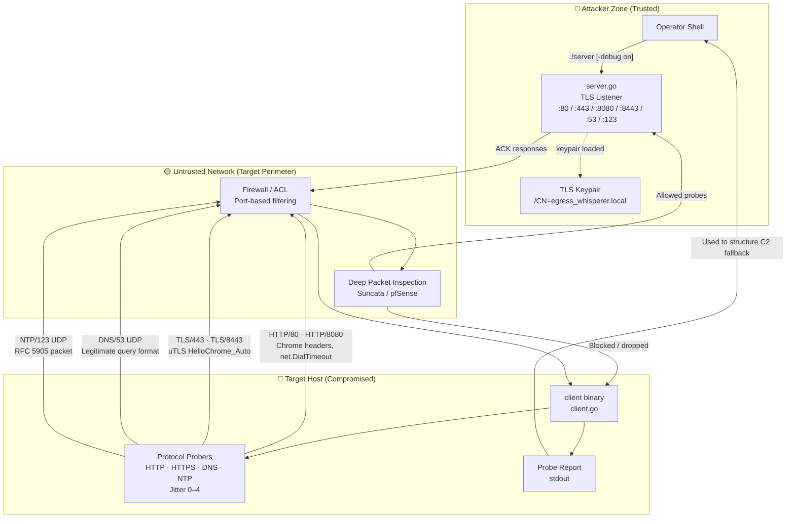

# Threat Model: egress_whisperer

> This document details the architectural threat model for `egress_whisperer` using the **STRIDE** methodology, a **DREAD** risk assessment, and technical alignments with the **MITRE ATT&CK** matrix.

---

| Field                | Value              |
| -------------------- | ------------------ |
| **Tool**             | egress_whisperer   |
| **Version Modelled** | master (current)   |
| **Date**             | November 2026      |
| **Author**           | Ajith G Nayak      |
| **Classification**   | Public – Portfolio |
| **Status**           | Final              |

---

## 1. Introduction

`egress_whisperer` is a lightweight Go binary designed for egress diagnostic purposes during authorized red team engagements. Once dropped on a compromised host, the client binary sends protocol-mimicking probes to an attacker-controlled listener across a range of ports and protocols (HTTPS/TLS on 443 and 8443, HTTP on 80 and 8080, DNS over UDP 53, NTP over UDP 123). It is DPI-aware, supports jitter-based stealth levels (0–4), and produces a report of which protocols survived the target's firewall. That report is then used to structure a C2 implant's fallback transport.

The purpose of this threat model is to identify operational security risks inherent in the tool's design. Threats such as threats to the operator's infrastructure, risks of detection, and the tool's intentional offensive capabilities mapped to industry frameworks.

---

## 2. Scope and Assumptions

### 2.1 In Scope

- `client.go` — the probe binary dropped on the target host
- `server.go` — the attacker-controlled listener
- TLS certificate and key material (`server.key`, `server.crt`)
- Protocol probe logic (HTTP, HTTPS/uTLS, DNS, NTP)
- Transport network between client and server (target firewall, DPI, IDS)
- The resulting probe report (stdout)

### 2.2 Out of Scope

- The initial access mechanism that delivers the client binary to the target
- Post-exploitation or privilege escalation subsequent to the egress report
- Host-based detection evasion (AV/EDR) of the binary itself
- Key management infrastructure (there is none; this is a diagnostic tool, not a persistent implant)

### 2.3 Assumptions

- The client binary is executed in the security context of the initial access account (non-root unless otherwise established).
- The server is running on attacker-controlled infrastructure with no exposure to the target's internal network.
- The target environment may run Suricata or equivalent IDS/IPS with signature-based inspection.
- The target firewall enforces egress ACL rules and may employ DPI on suspicious ports.
- Steganographic or covert persistence is not in scope; this tool is a one-shot diagnostic.

---

## 3. Architecture Overview

`egress_whisperer` follows a simple two-component model:
- **Server (`server.go`)**: Runs on the attacker machine. Listens simultaneously on all supported protocol ports. Receives probe connections and responds with an acknowledgement. Optionally runs in debug mode.
- **Client (`client.go`)**: Runs on the target. Spawns one goroutine per probe. Each probe crafts a protocol-authentic request (Chrome headers for HTTP, uTLS `HelloChrome_Auto` for HTTPS, real DNS query for UDP/53, NTP packet format for UDP/123). Reports results to stdout.
The `raw_packet_infra` subdirectory contains the raw socket infrastructure used for lower-level probing when standard dial fails.

---

## 4. System Boundary and Dataflow Diagram

**Trust boundary** sits between the target host and the network perimeter. The attacker zone is fully trusted. The network perimeter is adversarial. It may filter, inspect, and log all traversing traffic.

---

## 5. Assets

| Asset                          | Description                                                                        | Sensitivity |
| ------------------------------ | ---------------------------------------------------------------------------------- | ----------- |
| Operator IP / server address   | Disclosed in every probe packet as source IP.                                      | High        |
| TLS certificate (`server.crt`) | Carries CN=`egress_whisperer.local`; essentially forensic evidence.                | Medium      |
| TLS private key (`server.key`) | Used to decrypt HTTPS probes                                                       | High        |
| Client binary                  | Static Go binary; contains probe logic and server address                          | High        |
| Probe report                   | Documents allowed egress paths; directly useful for C2 fallback mechanism planning | Medium      |
| Attacker infrastructure        | The machine running `server.go`                                                    | Critical    |

---

## 6. Trust Boundaries

| Boundary | Description                                                                          |
| -------- | ------------------------------------------------------------------------------------ |
| **TB-1** | Attacker machine <-> Network: fully trusted outbound; operator controls this side    |
| **TB-2** | Network <-> Target: ACL + DPI enforced by the target environment                     |
| **TB-3** | Target host OS <-> Client binary: semi-trusted. EDR/AV may observe process behaviour |
| **TB-4** | Client binary <-> Stdout: trusted (local). report is not transmitted, only displayed |

---

## 7. Threat Actors

| Actor                              | Description                                                              |
| ---------------------------------- | ------------------------------------------------------------------------ |
| **Target SOC / Blue Team**         | Monitors network traffic, endpoint telemetry, and logs                   |
| **Automated IDS (Suricata/Snort)** | Signature-based inspection of probe traffic                              |
| **Network Forensics Analyst**      | Reviews PCAP post-incident                                               |
| **Competing Threat Actor**         | Low likelihood, but merits a consideration. Could subvert the diagnostic |

---
## 8. STRIDE Analysis
### 8.1 Client Binary (Target Host)

| ID     | Category                   | Threat Description                                                                                                                                                                              | Current Mitigation                                                                          | Gap                                                 |
| ------ | -------------------------- | ----------------------------------------------------------------------------------------------------------------------------------------------------------------------------------------------- | ------------------------------------------------------------------------------------------- | --------------------------------------------------- |
| EW-S01 | **Spoofing**               | Client binary impersonates a Chrome browser (HTTP headers) and legitimate DNS/NTP clients to deceive DPI inspection. This is intentional by design, to perform network-layer identity spoofing. | Protocol mimicry via uTLS and handcrafted Chrome headers. (Not a mitigation, but a feature) | —                                                   |
| EW-R01 | **Repudiation**            | The binary leaves no inherent C2-layer audit trail. No logging of probe destinations or results beyond stdout.                                                                                  | Stealth levels reduce footprint                                                             | EDR will log connections by PID/process name        |
| EW-I01 | **Information Disclosure** | Stdout report contains a map of allowed egress paths. If a blue team is keylogging or monitoring the session, the report discloses the operator's recon results.                                | Report is local-only (stdout)                                                               | No at-rest encryption of the report                 |
| EW-D01 | **Denial of Service**      | The process can be identified and killed by EDR or a blue team operator before the report completes. Concurrent goroutines mean partial results are possible if killed mid-run.                 | Stealth levels introduce jitter and delay timing                                            | No graceful partial-report save or probing retries. |
| EW-E01 | **Elevation of Privilege** | No privilege escalation built into the binary. The binary operates at the privilege level of the initial access account.                                                                        | Out of scope by design                                                                      | —                                                   |

### 8.2 Server (Attacker Machine)

| ID     | Category                   | Threat Description                                                                                                                                                                                                   | Current Mitigation | Gap                                                                            |
| ------ | -------------------------- | -------------------------------------------------------------------------------------------------------------------------------------------------------------------------------------------------------------------- | ------------------ | ------------------------------------------------------------------------------ |
| EW-S02 | **Spoofing**               | A defender could stand up a honeypot on the same IP/ports (if they learn the operator's server address), responding to probes to gather intelligence on the operator's infrastructure and collect the client binary. | None               | Use rotating infrastructure or domain-fronted servers                          |
| EW-T01 | **Tampering**              | A MITM positioned between client and server (like an enterprise proxy) could respond to probes with false acknowledgements, producing a false egress report.                                                         | None               | Add a shared-secret challenge/response to probe ACKs                           |
| EW-I02 | **Information Disclosure** | The TLS certificate uses a hardcoded CN of `/CN=egress_whisperer.local`. This string is a forensic evidence visible in JA3 logs, TLS certificate captures, or any SIEM inspecting TLS metadata.                      | None               | Randomise CN at build time or use a CA-signed certificate with a benign domain |

### 8.3 Protocol Probes (Network Layer)

| ID     | Category                   | Threat Description                                                                                                                                                                                                      | Current Mitigation                                      | Gap                                                                                                 |
| ------ | -------------------------- | ----------------------------------------------------------------------------------------------------------------------------------------------------------------------------------------------------------------------- | ------------------------------------------------------- | --------------------------------------------------------------------------------------------------- |
| EW-T02 | **Tampering**              | DNS responses are unsigned (no DNSSEC validation). An on-path adversary could return spoofed DNS responses, causing the tool to report false UDP/53 success.                                                            | Probe intent is directionality test, not data integrity | DNS success indicates reachability, not response authenticity, and must be printed so in the output |
| EW-T03 | **Tampering**              | NTP responses over UDP are trivially spoofable. A defender-controlled NTP reflector could acknowledge NTP probes even when the legitimate server is unreachable, skewing the report.                                    | None                                                    | Include a server-side nonce in NTP probe payload to validate origin                                 |
| EW-I03 | **Information Disclosure** | DNS queries are plaintext UDP and visible to on-path observers (ISP, firewall logs, DNS resolver operators), disclosing the operator's server IP as a destination.                                                      | DNS query format mimics legitimate lookups              | Destination IP is exposed regardless of query content                                               |
| EW-I04 | **Information Disclosure** | Concurrent probing at stealth level 0 creates a distinctive traffic burst to multiple ports simultaneously. Even with Chrome-mimicking headers, the multi-port burst pattern is anomalous for a single browser session. | Stealth levels 1–4 introduce jitter and serialisation   | At stealth level 0, burst pattern is detectable by entropy analysis                                 |

---

## 9. DREAD Risk Assessment

DREAD scoring: **D**amage (1–5) · **R**eproducibility (1–5) · **E**xploitability (1–5) · **A**ffected scope (1–5) · **Di**scoverability (1–5)  
Rating: **Low** ≤ 2.0 · **Medium** 2.1–3.0 · **High** 3.1–4.0 · **Critical** ≥ 4.1

| Threat ID | Description | D | R | E | A | Di | Score | Rating |
|---|---|---|---|---|---|---|---|---|
| EW-I02 | TLS cert CN `egress_whisperer.local` as IOC | 4 | 5 | 5 | 3 | 5 | **4.4** | **Critical** |
| EW-S02 | Honeypot server collects binary/infra data | 4 | 3 | 3 | 4 | 3 | **3.4** | **High** |
| EW-T01 | MITM produces false probe ACKs (bad report) | 4 | 2 | 3 | 3 | 2 | **2.8** | **Medium** |
| EW-I04 | Stealth-0 burst pattern flagged by IDS | 3 | 4 | 4 | 2 | 4 | **3.4** | **High** |
| EW-T02 | Spoofed DNS response = false egress success | 3 | 3 | 3 | 2 | 2 | **2.6** | **Medium** |
| EW-T03 | Spoofed NTP response = false egress success | 3 | 3 | 3 | 2 | 2 | **2.6** | **Medium** |
| EW-I03 | Operator server IP visible in DNS queries | 3 | 5 | 1 | 2 | 5 | **3.2** | **High** |
| EW-R01 | EDR logs process network connections by PID | 3 | 4 | 1 | 2 | 5 | **3.0** | **Medium** |
| EW-D01 | Blue team kills process before report completes | 2 | 3 | 2 | 1 | 3 | **2.2** | **Medium** |
| EW-E01 | No privilege escalation (by design, not a risk) | 1 | 1 | 1 | 1 | 1 | **1.0** | **Low** |

---

## 10. MITRE ATT&CK Matrix Alignment

| Tactic | Technique ID | Technique Name | Implementation in `egress_whisperer` |
|---|---|---|---|
| Discovery | **T1046** | Network Service Scanning | Core function: probing target-side egress ports to map firewall ACL |
| Discovery | **T1016** | System Network Configuration Discovery | The egress report reveals network topology (what is blocked/allowed from internal segment) |
| Command and Control | **T1071** | Application Layer Protocol | Probes craft legitimate-looking application-layer traffic |
| Command and Control | **T1071.001** | Web Protocols | HTTP probes send handcrafted Chrome headers over `net.DialTimeout` on :80 and :8080 |
| Command and Control | **T1071.004** | DNS | DNS probes send legitimate-format queries over UDP/53 |
| Command and Control | **T1573** | Encrypted Channel | TLS probes establish TLS sessions on :443 and :8443 |
| Command and Control | **T1573.002** | Asymmetric Cryptography | uTLS `HelloChrome_Auto` performs TLS handshake mimicking Chrome's cipher suite ordering |
| Defense Evasion | **T1027** | Obfuscated Files or Information | Protocol mimicry obscures probe intent within legitimate-looking application traffic |
| Defense Evasion | **T1205** | Traffic Signaling | The probe cycle (stealth levels) resembles normal browsing/DNS/NTP traffic patterns |
| Defense Evasion | **T1036** | Masquerading | Chrome header sets and uTLS fingerprint masquerade as a real Chrome browser |
| Execution | **T1059** | Command and Scripting Interpreter | `run_client.sh` / `run_server.sh` are shell wrappers for binary execution |
| Resource Development | **T1587.001** | Develop Capabilities: Malware | The tool itself is purpose-built offensive tooling, compiled per engagement |

---

## 11. Security Controls and Mitigations

| Threat ID       | Recommended Control                                                                                                                                  | Priority |
| --------------- | ---------------------------------------------------------------------------------------------------------------------------------------------------- | -------- |
| EW-I02          | Randomise TLS cert CN at build time (e.g., inject random hostname via `ldflags`); alternatively, obtain a CA-signed cert for a benign-looking domain | Critical |
| EW-S02          | Use short-lived, single-use infrastructure; rotate server IPs per engagement                                                                         | High     |
| EW-I04          | Default to stealth level ≥ 2 for most environments. stealth-0 recommended for lab-only                                                               | High     |
| EW-T01          | Add a shared secret (HMAC or nonce) to ACK responses; client validates before recording success                                                      | Medium   |
| EW-T02 / EW-T03 | Add server-side echo validation: include a random token in probe payload, verify it in ACK                                                           | Medium   |
| EW-I03          | Support DNS-over-HTTPS (DoH) probe mode to prevent plaintext DNS exposure                                                                            | Medium   |
| EW-R01          | Compile with `-trimpath` and `-ldflags="-s -w"` to reduce binary metadata; rename binary to a benign name before deployment                          | Medium   |

---

## 12. Residual Risk Summary

After applying the recommended controls above, the following risks remain inherent to the tool's nature and cannot be fully eliminated:

| Residual Risk | Rationale |
|---|---|
| **Operator IP exposure** | Every probe packet originates from the client and terminates at the attacker server. Even with domain fronting, correlating source/destination is possible for a network forensics analyst with full PCAP. |
| **Static binary detectability** | The Go binary is a static ELF/PE. Host-based AV with file hash or import analysis can identify it once a sample is submitted. Beyond the scope of this tool. |
| **Process telemetry** | EDR products (CrowdStrike, Defender for Endpoint) log process creation and network connections. The binary's behaviour is diagnostic in nature and atypical for most user processes. |
| **UDP probe spoofability** | DNS and NTP probe responses cannot be cryptographically validated without server-side echo, which is not currently implemented. |

